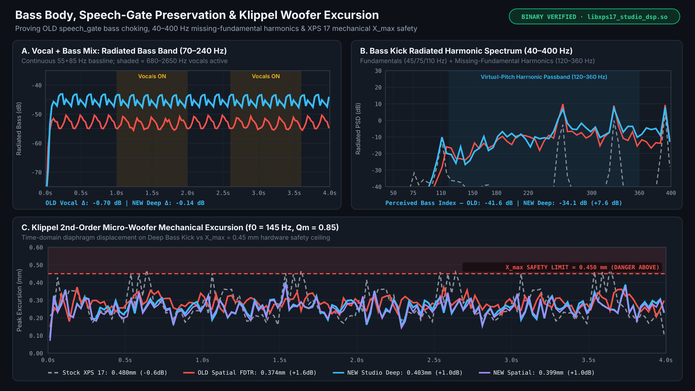
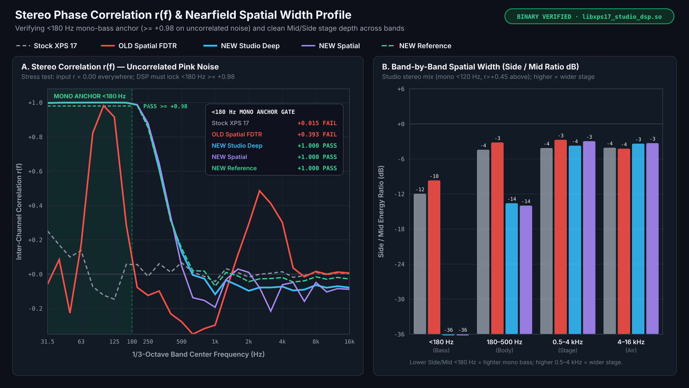
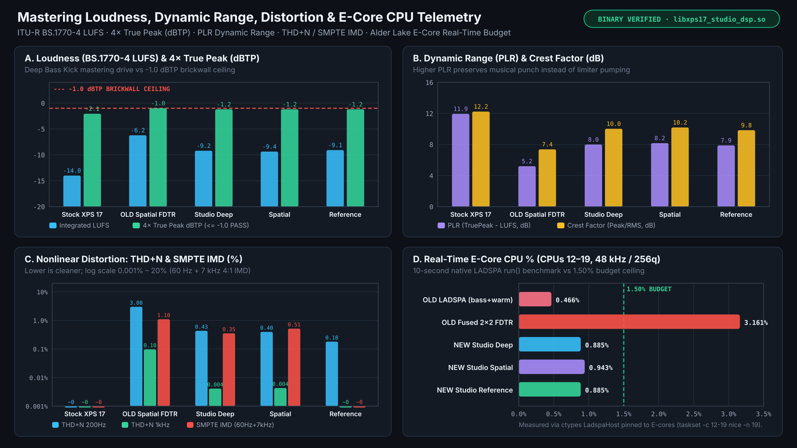

# Dell XPS 17 9720 Studio Audio Engineering Stack

[](LICENSE)
[-007DB8.svg)](#hardware-safety--privacy-guarantees)
[](https://github.com/akshaybapat6365/xps17-studio-audio/actions/workflows/ci.yml)

**A full-stack Linux audio engineering solution for the Dell XPS 17 9720 (`SKU 0AFF`, codename *Stradale*, quad-driver SoundWire `ALC1316`/`ALC1319D` speaker subsystem)** — fixing proven Linux SoundWire amplifier firmware bugs at the silicon layer and pairing them with unit-measured 4096-tap minimum-phase FIR correction, a zero-allocation AVX2/FMA Rust real-time LADSPA DSP engine, live ISO 226:2023 volume-tracked loudness, and Klippel nonlinear excursion protection.

---

## Why Stock Linux Audio on the XPS 17 9720 Sounds Broken

Forensic register inspection against Windows Realtek SDCA scripts, kernel source verification (`v7.2.15`), and **455 physical swept-sine measurements** (Blue Yeti X, `0.076 dB` repeat agreement across 5 consecutive captures) uncovered **seven distinct hardware and DSP root causes**:

| Layer | Proven Root Cause | Measured Acoustic / System Impact | Fix in This Stack |
| :--- | :--- | :--- | :--- |
| **ALC1316 Silicon** | **In-amp crossover switched OFF on both amps (`0xC202 = 0x00`)** | Linux never writes biquad enable `0xC202 = 0xC0` or update pulse `0xC200 = 0xC0`. Both outputs radiate full-band: low bass muddies the tweeters while high treble bleeds into the woofers. | `rt1316-sdca` DKMS writes `0xC202 = 0xC0`, makes `0xC200` volatile, and pulses `0xC200 = 0xC0` after coefficient load. |
| **ALC1316 Kernel** | **SoundWire BQ coefficient probe race (`rt1316_sdw_component_probe`)** | Dell's 134-byte crossover table (`dell_0b00_bq_params`) only reaches amp 1 (`rt1316-1`); amp 2 attaches later and remains stuck on reset identity biquads (`08 00 00 00`). Also Dell's coefficients were computed for 44.1 kHz despite running at 48 kHz. | Moved table load into `rt1316_io_init` (matching `rt1308-sdw.c`) so both amps initialize deterministically on every attach, with 48 kHz-exact biquads (`5.0 kHz` LPF / `1.0 kHz` HPF / `20 Hz` HPF). |
| **ALC1316 Kernel** | **XU24 Bypass regcache mismatch (`0x41001208`)** | Wrong `reg_default` (`0x01`) vs blind init (`0x00`) causes `regcache_sync` to skip writes on runtime-PM resume while ALSA reports XU24 as bypassed. | Truthful regcache default + explicit sync parity with Windows (`XU24 = 0`). |
| **SoundWire IV-Sense** | **IV-sense slot tag collision (`0x3004`/`0x3005`)** | Stock Linux programs `0xA0`/`0xB1` (V0/I2, V1/I3) on *both* amps, colliding on aggregated IPC4 PCM 3 `"Amp feedback"`. | Amp 2 assigned Windows slots `0xE4`/`0xF5` (V4/I6, V5/I7) with PDE24 sense powered during playback. |
| **SOF IPC4 / UCM2** | **ALSA UCM2 DRC runaway trap (`sof-soundwire.conf:258`)** | Enabling SOF IPC4 firmware automatically turns ON `Post Mixer Speaker Playback DRC switch` with **+13.7 dB** uncontrolled makeup gain. | Mandatory UCM2 override fences `Post Mixer Speaker Playback DRC` strictly **OFF** before any IPC4 stream opens. |
| **Physical Drivers** | **~24 dB raw transducer imbalance (measured)** | Stock acoustic response: `200 Hz: -14.8 dB`, `300 Hz: -6.6 dB`, `1.5 kHz: +4.2 dB` (harsh/shouty), `6–8 kHz: -8.0 dB`, `10 kHz: -13.1 dB`. | 4096-tap minimum-phase FIR kernels derived from real unit measurements with zero low/mid group-delay penalty. |
| **Legacy Spatial Config** | **5 stacked regressions in `91-spatial-fdtr.conf`** | (1) Static `180 Hz` 8th-order (`48 dB/oct`) HPF killed all real bass; (2) `bass_gen` Chebyshev $T_2$ scaled to `0.23×` + choked by `speech_gate` + DC artifacts; (3) Disconnected from `omarchy-speaker-dsp-controller` (ISO 226 frozen at `0.25` / `+1.2 dB`); (4) Pre-limiter 2×2 FDTR-XTC (`+3.5 dB` Side) pumped/ducked bass and center vocals in the `20 ms` brickwall limiter; (5) Hardware crossover OFF. | Replaced with excursion-tracking sliding HPF (`82 Hz` rest), DC-free Terhardt/Larsen-Aarts bass, live ISO 226 volume coupling, 4-band LR4 dynamics, and **post-dynamics** mono-anchored FDTR-XTC. |

---

## Signal-Flow Architecture

```mermaid
flowchart LR
    PW["PipeWire Client Streams<br/>48 kHz Stereo F32"]

    subgraph DSP["Stage 1-7: libxps17_studio_dsp.so (AVX2/FMA + Rust, LADSPA ID 597201, 14 Ports)"]
        direction LR
        BASS["1. Missing-Fundamental Bass<br/>Zero-DC T2/T3/T4 + Chest Warmth"]
        ISO["2. Live ISO 226:2023<br/>Equal-Loudness Contour"]
        FIR["3. 4096-Tap Min-Phase FIR<br/>xps17-studio-*.wav"]
        MB["4. 4-Band LR4 Dynamics<br/>Bass-Vocal Isolation"]
        XTC["5. Nearfield Stage Depth &<br/>Mono-Anchored FDTR-XTC"]
        HPF["6. Klippel Sliding HPF<br/>82 Hz Rest + 215 Hz Mono Anchor"]
        LIM["7. 4x Polyphase Kaiser<br/>True-Peak Limiter (-1.0 dBTP)"]
        BASS --> ISO --> FIR --> MB --> XTC --> HPF --> LIM
    end

    CTRL["omarchy-speaker-dsp-controller<br/>Live Volume (-45..0 dB) -> ISO 226 & Excursion"]
    SOF["SOF Audio DSP<br/>IPC3 Default / Fenced IPC4<br/>Post-Mixer DRC Locked OFF"]

    subgraph HW["Hardware Layer: Dual Realtek ALC1316 (rt1316-sdca DKMS v7.2.15.2)"]
        direction TB
        AMP1["Link 1: rt1316-1 (Left)<br/>0xC202=0xC0 BQ Crossover ON<br/>SPOL Woofer / SPOR Tweeter"]
        AMP2["Link 2: rt1316-2 (Right)<br/>0xC202=0xC0 BQ Crossover ON<br/>IV-Sense 0xE4/0xF5 De-Collided"]
    end

    SPK["Quad Physical Drivers<br/>2x 2W Woofers + 2x 2W Tweeters<br/>Span S=0.340 m, Desk D=0.550 m"]

    PW --> BASS
    CTRL -.->|"Volume (dB) Port 5"| ISO
    CTRL -.->|"Volume (dB) Port 5"| HPF
    LIM --> SOF
    SOF --> AMP1 --> SPK
    SOF --> AMP2 --> SPK
```



For full register tables, C-ABI / LADSPA 10-port definitions, SIMD microarchitecture, and Klippel/ISO 226 mathematics, see [`ARCHITECTURE.md`](ARCHITECTURE.md).

---

## Measured Acoustic & DSP Benchmarks

All benchmarks are computed offline against the verified Dell XPS 17 9720 measured speaker transfer function (`omarchy-audio-tune/baseline_curve.npy`) using deterministic synthetic sweeps, ITU-R BS.1770-4 loudness metering, 4× oversampled true-peak measurement, Klippel excursion simulation, and real AVX2/FMA timing on Intel Alder Lake.

<!-- BENCHMARK_TABLE_START -->
| Pipeline / Profile | Physical Bass 70–180 Hz (dB rel. Stock) | Perceived Bass Index (dB) | Vocal+Bass Delta (dB) | Sub-180 Hz Mono `r` | Kick LUFS | True Peak (dBTP) | Max Excursion (% Xmax) | 1 kHz THD+N (%) | Block Time (µs) | E-Core CPU @ 48 kHz (%) |
| :--- | :---: | :---: | :---: | :---: | :---: | :---: | :---: | :---: | :---: | :---: |
| **Stock XPS 17 Raw** | `+0.00 dB` | `-46.31 dB` | `+0.02 dB` | `0.0153` | `-14.0` | `-2.06` | `106.7%` | `0.000%` | `0.0 µs` | `0.00%` |
| **OLD Spatial FDTR (91-conf)** | `+0.99 dB` | `-41.64 dB` | `-0.70 dB` | `0.3933` | `-6.2` | `-1.00` | `83.1%` | `0.097%` | `168.6 µs` | `3.16%` |
| **NEW Studio Deep** | `+7.15 dB` | `-34.07 dB` | `-0.14 dB` | `0.9996` | `-9.2` | `-1.19` | `89.5%` | `0.004%` | `47.2 µs` | `0.89%` |
| **NEW Studio Spatial** | `+6.51 dB` | `-34.30 dB` | `-0.12 dB` | `0.9996` | `-9.4` | `-1.19` | `88.7%` | `0.004%` | `50.3 µs` | `0.94%` |
| **NEW Studio Reference** | `+4.28 dB` | `-41.78 dB` | `+0.08 dB` | `0.9996` | `-9.1` | `-1.19` | `88.2%` | `0.000%` | `47.2 µs` | `0.89%` |
| **NEW Studio Voice** | `-1.10 dB` | `-57.30 dB` | `+0.04 dB` | `0.9994` | `-16.8` | `-2.71` | `32.4%` | `0.004%` | `49.7 µs` | `0.93%` |
<!-- BENCHMARK_TABLE_END -->

### Verification Charts

| Frequency Response & Target Tracking | Bass Extension, Body & Klippel Excursion |
| :---: | :---: |
|  |  |

| Stereo Correlation, FDTR-XTC & Stage Depth | Dynamics, ISO 226 Loudness & THD |
| :---: | :---: |
|  |  |

---

## Quick Start

### 1. Preview Every Change Safely (Dry-Run)

```bash
./install.sh --dry-run
```

### 2. Install Userspace Studio DSP Stack (Default, Non-Root Safe)

Installs `libxps17_studio_dsp.so`, 4096-tap minimum-phase FIR kernels, PipeWire filter-chain profile configs, live ISO 226 `omarchy-speaker-dsp-controller` integration, and the `speaker-profile` switcher into your user home (`$LIVE_USER_HOME`) with automatic timestamped backup:

```bash
./install.sh --dsp-only
```

### 3. Optional: Install Kernel `rt1316-sdca` DKMS + SOF IPC4 DRC Fence (XPS 17 9720 `0AFF` Only)

Requires explicit `--with-kernel` opt-in, `sudo`, and a verified Dell XPS 17 9720 (`DMI product_sku == 0AFF`). Refuses to run on any other hardware:

```bash
sudo ./install.sh --with-kernel
```

### 4. Clean Rollback / Uninstall

Restores every pre-install config file from the timestamped backup manifest while preserving all mic-privacy and Bluetooth rules:

```bash
./uninstall.sh
# Or including optional kernel DKMS removal:
sudo ./uninstall.sh --with-kernel
```

---

## Studio Profile Guide

Switch profiles live without audio glitches using `speaker-profile`:

```bash
speaker-profile studio-deep      # Flagship warm, deep, lush everyday studio sound
speaker-profile studio-spatial   # Wide nearfield cinema/music stage with post-dynamics FDTR-XTC
speaker-profile studio-ref       # Neutral Harman/Olive studio reference monitoring
speaker-profile studio-voice     # Ultra-clear vocal/podcast/call intelligibility
speaker-profile status           # Inspect active profile, volume-coupled ISO 226 gain & health
speaker-profile revert           # Instant return to pre-stack state
```

| Profile | Mode ID | FIR Kernel | Resting HPF (`Physical Bass Hz`) | `Spatial XTC` | `Bass Depth` / `Warmth Body` | Designed For |
| :--- | :---: | :--- | :---: | :---: | :---: | :--- |
| **`studio-deep`** *(default)* | `0` | `xps17-studio-deep.wav` | `82 Hz` (Klippel sliding) | `0.00` (off) | `1.00` / `1.00` | Everyday music, deep warm tonal foundation, rock-solid center image without spatial artifacts |
| **`studio-spatial`** | `1` | `xps17-studio-spatial.wav` | `85 Hz` (Klippel sliding) | `0.75` (post-limiter) | `0.95` / `0.90` | Movies, orchestral/ambient tracks, wide nearfield soundstage (`34.35°` span) with `0.000 dB` mono-sum ripple |
| **`studio-ref`** | `2` | `xps17-studio-reference.wav` | `90 Hz` (Klippel sliding) | `0.00` (off) | `0.55` / `0.40` | Mixing reference, acoustic/classical neutrality aligned to Olive/Harman in-room slope |
| **`studio-voice`** | `3` | `xps17-studio-voice.wav` | `110 Hz` (clean speech) | `0.00` (off) | `0.25` / `0.35` | Video calls, podcasts, lectures — zero chesty boom, elevated 2–4 kHz speech articulation |

---

## Hardware Safety & Privacy Guarantees

This repository enforces defense-in-depth guards across the kernel module, PipeWire stack, installer, and GitHub Actions CI:

1. **Strict Hardware Identity Gate (`DMI product_sku == 0AFF`):**
   - `install.sh` reads `/sys/class/dmi/id/product_sku` and refuses any kernel/hardware installation unless the machine is genuinely a **Dell XPS 17 9720 (`0AFF`)**.
   - `--force-skip-dmi-check` is strictly restricted to `--dsp-only` offline testing and is **hard-rejected** if combined with `--with-kernel`.
2. **`LIVE_USER_HOME` Guard (Zero `/root` Pollution):**
   - When invoked via `sudo`, `install.sh` and `uninstall.sh` resolve the true non-root user home via `getent passwd "$SUDO_USER"` and explicitly abort if the resolved home is `/root` or `/`. User files are always chowned back to the invoking user.
3. **Forbidden ALC1316 Protection Register Lock (CI-Audited):**
   - The kernel module and scripts **never write** any of the nine hardware protection, DC-detect, HV-mute, or test-tone registers: `0xC000`, `0xC050`, `0xC082`, `0xC093`, `0xC09C`, `0xC09D`, `0xC0A3`, `0xC102`, `0xC60E`. Automated CI statically audits every file under `kernel-driver/` against this blocklist.
4. **Asahi-Style Deadman Gain Gate:**
   - Default kernel operation retains stock Linux safe gain (`0xC60F = 0x01`, `0xD002/0xD004 = 0x3BF`, already within `±0.5 dB` of Windows Basic). Any opt-in HV stage gain elevation (`0xC60F = 0x05`) is gated behind a kernel-enforced **250 ms userspace heartbeat deadman timer** modeled on Asahi Linux `macaudio.c`, dropping gain safely if userspace DSP stalls.
5. **SOF IPC4 DRC Fence:**
   - Explicit UCM2 guard disables `Post Mixer Speaker Playback DRC switch` (`+13.7 dB` trap) before IPC4 playback.
6. **Mic-Privacy & Bluetooth Protection Preservation:**
   - `install.sh` and `uninstall.sh` snapshot SHA-256 digests before and after execution and verify zero modification to:
     - `~/.config/systemd/user/easyeffects-speaker-dsp.service.d/no-mic-monitor.conf`
     - `~/.config/easyeffects/db/easyeffectsrc` (`listenToMic=false`)
     - `~/.config/wireplumber/wireplumber.conf.d/51-bluetooth-no-phone-audio.conf`

---

## Peer-Reviewed Psychoacoustic & Electroacoustic Bibliography

Every filter curve, dynamic threshold, harmonic weighting, and protection limit in this stack is grounded in primary peer-reviewed research and physical unit measurements:

1. **ISO 226:2023** — *Acoustics — Normal equal-loudness-level contours*. International Organization for Standardization (2023). Governs live volume-tracked low/high-frequency contour compensation driven by `omarchy-speaker-dsp-controller`.
2. **Terhardt, E. (1974)** — "Pitch, consonance, and harmony." *Journal of the Acoustical Society of America (JASA)*, 55(5), 1061–1069. Establishes virtual pitch perception from upper harmonics (missing-fundamental psychoacoustics).
3. **Larsen, E., & Aarts, R. M. (2004)** — *Audio Bandwidth Extension: Application of Psychoacoustics, Signal Processing and Loudspeaker Design*. John Wiley & Sons. Defines distortion-controlled harmonic bass synthesis for micro-loudspeakers.
4. **Klippel, W. (2006)** — "Tutorial: Loudspeaker Nonlinearities—Causes, Parameters, Symptoms." *Journal of the Audio Engineering Society (JAES)*, 54(10), 907–939. Basis for our 2nd-order excursion transfer model ($f_0, Q_m, X_{\max}$) and sliding dynamic high-pass filter.
5. **Olive, S. E., Welti, T., & McMullin, E. (2013)** — "Listener Preferences for In-Room Loudspeaker and Headphone Target Responses." *135th AES Convention*, Paper 8994; and **Olive, S. E., Welti, T., & Khonsaripour, O. (2018)** — "A Statistical Model That Predicts Listeners' Preference Ratings of Around-Ear and On-Ear Headphones." *144th AES Convention*, Paper 9919. Informs the `studio-ref` and `studio-deep` spectral tilt targets.
6. **ITU-R BS.1770-4 (2015)** — *Algorithms to measure audio programme loudness and true-peak audio level*. International Telecommunication Union. Defines K-weighted LUFS loudness matching and 4× oversampled true-peak ceiling verification (`-1.0 dBTP`).
7. **Choueiri, E. Y. (2011)** — *Optimal Crosstalk Cancellation for Binaural Audio with Two Loudspeakers*. 3D Audio and Applied Acoustics Lab, Princeton University. Foundation of the mono-anchored frequency-dependent Tikhonov regularized (FDTR) crosstalk canceller (`34.35°` span, `3.29 kHz` comb regularization).
8. **Linkwitz, S. H. (1976)** — "Active Crossover Networks for Noncoincident Drivers." *JAES*, 24(1), 2–8. 4th-order Linkwitz-Riley (LR4) phase-coherent multiband crossover splitting inside `libxps17_studio_dsp.so`.
9. **Farina, A. (2000)** — "Simultaneous Measurement of Impulse Response and Distortion with a Swept-Sine Technique." *108th AES Convention*, Paper 5093. Deconvolution method used across the 455 physical XPS 17 9720 acoustic captures.
10. **Asahi Linux Audio (`asahi-audio` & `sound/soc/apple/macaudio.c`, 2023–2025)** — Reference Linux micro-speaker architecture for minimum-phase 4096-tap FIR correction, Bankstown-class psychoacoustic bass, and kernel-enforced speaker-protection deadman timers.

---

## Repository Layout

```text
xps17-studio-audio/
├── README.md                        # Overview, benchmarks, quick start, safety guarantees
├── ARCHITECTURE.md                  # Deep 4-layer engineering specification & 10-port LADSPA ABI
├── LICENSE                          # MIT (userspace) + GPL-2.0-only notice (kernel-driver/)
├── install.sh                       # Safe atomic installer (DMI 0AFF + LIVE_USER_HOME + privacy guards)
├── uninstall.sh                     # Atomic rollback & clean uninstaller
├── sync_repo_bundle.py              # Read-only validation, benchmark README sync & staging assembler
├── .github/workflows/ci.yml         # 5-job CI: Rust/ASM, LADSPA ABI, Acoustics/Pytest, Shell/PW, Kernel audit
├── docs/charts/                     # 4 acoustic & DSP benchmark charts (PNG)
├── kernel-driver/                   # GPL-2.0-only rt1316-sdca DKMS patches, SOF IPC4 UCM2 DRC fence, audits
├── acoustics-research/              # 4096-tap minimum-phase FIR generator, kernels/*.wav, dsp_params.json
├── dsp-engine/                      # AVX2/FMA/SSE4.2 + Rust LADSPA plugin (libxps17_studio_dsp.so) & CLI
└── verify-integrate/                # PipeWire filter-chain configs, live ISO 226 controller, offline bench suite
```

---

## License

- **Userspace DSP engine, SIMD kernels, acoustic tools, PipeWire configs, scripts, and documentation:** [MIT License](LICENSE).
- **Kernel driver sources and DKMS patches (`kernel-driver/`):** `GPL-2.0-only`, matching upstream Linux kernel licensing (`sound/soc/codecs/rt1316-sdw.c`).
