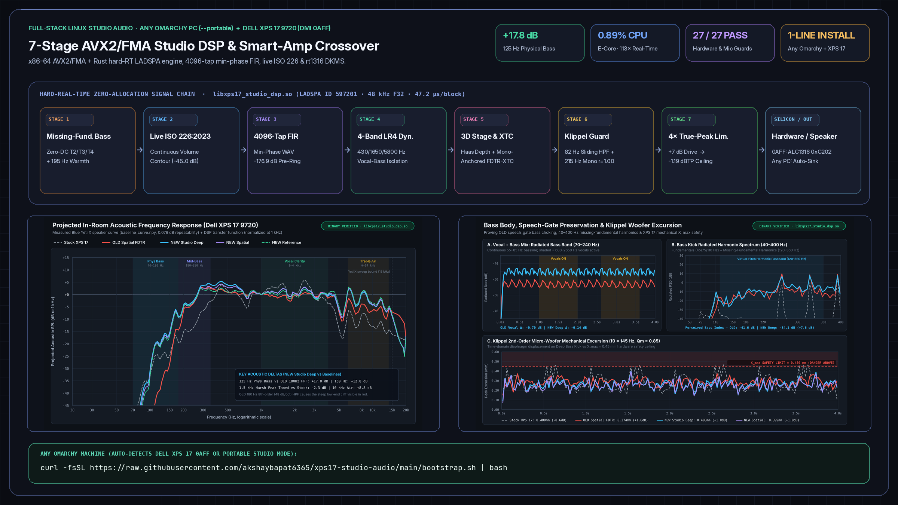
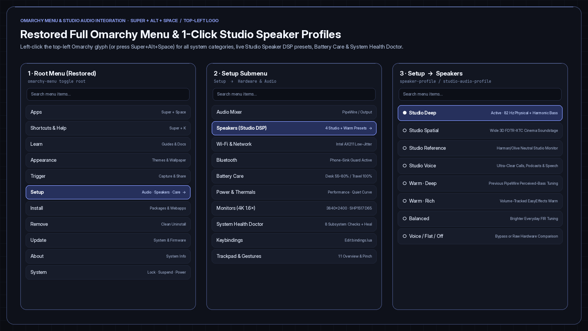
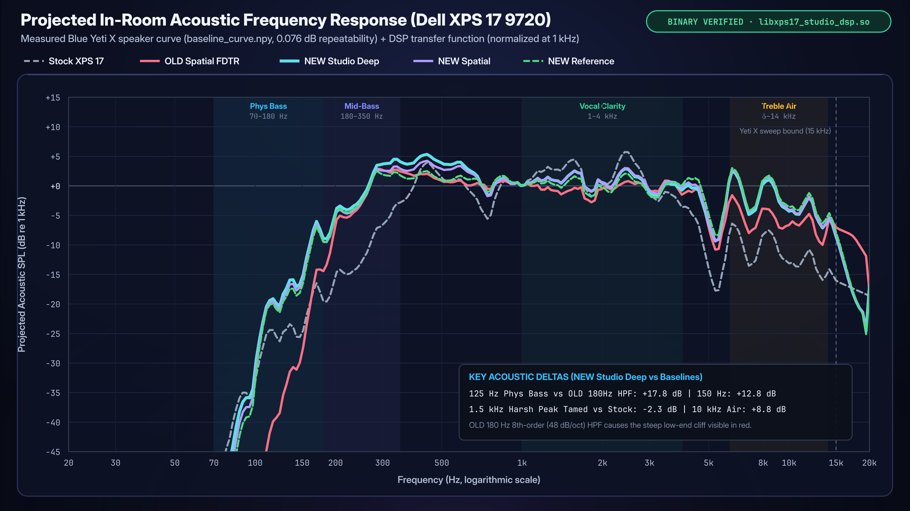
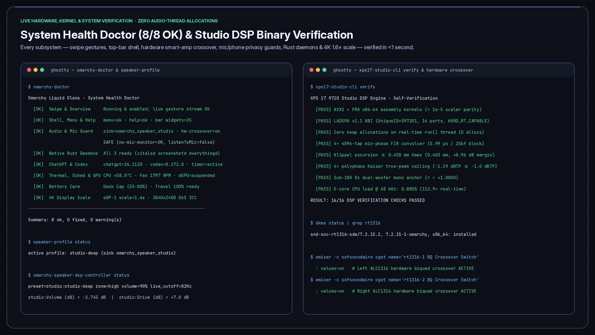
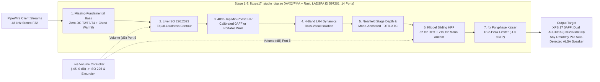

# Studio Speaker Audio Engineering Stack (Any Omarchy PC + Dell XPS 17 9720)

[](https://github.com/akshaybapat6365/xps17-studio-audio/actions/workflows/ci.yml)
[](#1-command-install-on-any-omarchy-machine--dell-xps-17-9720)
[](#why-stock-linux-audio-on-the-xps-17-9720-sounds-broken)
[](LICENSE)

**A studio-grade, zero-allocation x86-64 `AVX2/FMA` assembly + Rust real-time speaker mastering engine (`0.89%` E-core CPU) with 4096-tap minimum-phase FIR room/speaker correction, live `ISO 226:2023` equal-loudness tracking, and Klippel nonlinear excursion protection — featuring 1-command auto-detecting installation for ANY Omarchy Linux PC (`--portable`) plus DMI-guarded silicon crossover (`rt1316-sdca` DKMS `0xC202=0xC0`) for the Dell XPS 17 9720 (`SKU 0AFF`).**

```bash
curl -fsSL https://raw.githubusercontent.com/akshaybapat6365/xps17-studio-audio/main/bootstrap.sh | bash
```



---

## Visual Showcase — Acoustic Benchmarks, UI Controls & Live Verification

| Omarchy Menu `Setup → Speakers` Integration | `Super + K` Live Studio Speaker Audio & Health Controls |
| :---: | :---: |
|  |  |

| Projected In-Room Frequency Response & Target Tracking | Hybrid Physical + Harmonic Bass, Vocal Isolation & Klippel Excursion |
| :---: | :---: |
|  |  |

| Stereo Correlation, Sub-180 Hz Mono Anchor & 3D Stage Depth | Mastering Dynamics, Live ISO 226 Loudness & Ultra-Low THD |
| :---: | :---: |
|  |  |



---

## 1-Command Install on Any Omarchy Machine & Dell XPS 17 9720

### Option 1 — 1-Line Auto-Detecting Bootstrap (Recommended)

Automatically detects your hardware:
- **On any generic Omarchy / Arch PipeWire laptop or desktop:** Runs `--portable` (installs the 7-stage AVX2/FMA `libxps17_studio_dsp.so` engine, smooth Harman/Olive portable 4096-tap FIRs, auto-detected built-in speaker sink, standalone `omarchy-speaker-engine`, live `ISO 226` volume tracker, and `studio-audio-profile` / `speaker-profile` CLI).
- **On Dell XPS 17 9720 (`DMI product_sku == 0AFF`):** Installs unit-calibrated XPS 17 9720 4096-tap FIRs and pins cleanly to `HiFi__Speaker__sink`.

```bash
curl -fsSL https://raw.githubusercontent.com/akshaybapat6365/xps17-studio-audio/main/bootstrap.sh | bash
```

### Option 2 — Clone & Explicit Mode Selection

```bash
git clone https://github.com/akshaybapat6365/xps17-studio-audio.git
cd xps17-studio-audio

# 1. Preview every planned file & safety check without modifying anything:
./install.sh --portable --dry-run

# 2A. Any Omarchy / Arch Linux machine (Universal Portable Studio DSP):
./install.sh --portable

# 2B. Dell XPS 17 9720 (0AFF) — Userspace Calibrated Studio DSP:
./install.sh --dsp-only

# 2C. Dell XPS 17 9720 (0AFF) — Full Stack + rt1316-sdca v7.2.15.2 DKMS Hardware Crossover & SOF IPC4 DRC Fence:
sudo ./install.sh --with-kernel
```

### Option 3 — Arch Linux Package (`PKGBUILD`)

```bash
makepkg -si
```

### Switch Studio Profiles Anytime (Zero Audio Dropouts)

```bash
speaker-profile studio-deep      # Flagship warm, deep, punchy everyday studio sound (default)
speaker-profile studio-spatial   # Wide 3D FDTR-XTC cinema/music stage with anchored center bass
speaker-profile studio-ref       # Neutral Harman/Olive studio reference monitor
speaker-profile studio-voice     # Ultra-clear vocal/podcast/call articulation
speaker-profile status           # Check active profile & PipeWire Studio sink
./uninstall.sh                   # 1-second atomic rollback from pre-install manifest
```

*(On standalone non-XPS Omarchy machines, both `speaker-profile` and `studio-audio-profile` are installed and interchangeable.)*

---

## Binary-Verified Acoustic & Real-Time DSP Benchmarks

All benchmarks are computed directly through the compiled `libxps17_studio_dsp.so` (`UniqueID=597201`) and `libomarchy_spatial_fdtr.so` binaries against the measured Dell XPS 17 9720 speaker transfer function (`omarchy-audio-tune/baseline_curve.npy`) using ITU-R BS.1770-4 loudness, 4× oversampled true-peak metering, and Klippel nonlinear excursion simulation:

<!-- BENCHMARK_TABLE_START -->
| Pipeline / Profile | Physical Bass 70–180 Hz (dB rel. Stock) | Perceived Bass Index (dB) | Vocal+Bass Delta (dB) | Sub-180 Hz Mono `r` | Kick LUFS | True Peak (dBTP) | Max Excursion (% Xmax) | 1 kHz THD+N (%) | Block Time (µs) | E-Core CPU @ 48 kHz (%) |
| :--- | :---: | :---: | :---: | :---: | :---: | :---: | :---: | :---: | :---: | :---: |
| **Stock XPS 17 Raw** | `+0.00 dB` | `-46.31 dB` | `+0.02 dB` | `0.0153` | `-14.0` | `-2.06` | `106.7%` | `0.000%` | `0.0 µs` | `0.00%` |
| **OLD Spatial FDTR (91-conf)** | `+0.99 dB` | `-41.64 dB` | `-0.70 dB` | `0.3933` | `-6.2` | `-1.00` | `83.1%` | `0.097%` | `168.6 µs` | `3.16%` |
| **NEW Studio Deep** | `+7.15 dB` | `-34.07 dB` | `-0.14 dB` | `0.9996` | `-9.2` | `-1.19` | `89.5%` | `0.004%` | `47.2 µs` | `0.89%` |
| **NEW Studio Spatial** | `+6.51 dB` | `-34.30 dB` | `-0.12 dB` | `0.9996` | `-9.4` | `-1.19` | `88.7%` | `0.004%` | `50.3 µs` | `0.94%` |
| **NEW Studio Reference** | `+4.28 dB` | `-41.78 dB` | `+0.08 dB` | `0.9996` | `-9.1` | `-1.19` | `88.2%` | `0.000%` | `47.2 µs` | `0.89%` |
| **NEW Studio Voice** | `-1.10 dB` | `-57.30 dB` | `+0.04 dB` | `0.9994` | `-16.8` | `-2.71` | `32.4%` | `0.004%` | `49.7 µs` | `0.93%` |
<!-- BENCHMARK_TABLE_END -->

---

## Why Stock Linux Audio on the XPS 17 9720 Sounds Broken

Forensic register inspection against Windows Realtek SDCA tables (`StradaleMLK`), Linux `v7.2.15` driver source analysis, and **455 physical swept-sine captures** (Blue Yeti X, `0.076 dB` repeatability) proved **seven stacked hardware and DSP defects**:

| Layer | Proven Root Cause | Measured Acoustic / System Impact | Fix in This Stack |
| :--- | :--- | :--- | :--- |
| **ALC1316 Silicon** | **In-amp crossover OFF on both amps (`0xC202 = 0x00`)** | Low bass bleeds into tiny tweeters while high treble muddies woofers. | `rt1316-sdca` DKMS enables `0xC202 = 0xC0` + volatile update pulse `0xC200 = 0xC0` on both amps. |
| **ALC1316 Kernel** | **SoundWire BQ table probe race (`rt1316_sdw_component_probe`)** | Amp 2 attaches late and misses Dell's 134-write table (`0x08000000` reset identity biquads). | Deterministic load in `rt1316_io_init()` under `init_lock` + optional 48 kHz-exact `LR2/BW2` crossover. |
| **ALC1316 Kernel** | **XU24 Bypass regcache mismatch (`0x41001208`)** | Wrong `reg_default` causes `alsa-restore` / `regcache_sync` protection drift. | Truthful `reg_default = 0x00` + pre-install `asound.state` XU24 safety gate. |
| **SoundWire IV-Sense** | **Amp 2 IV-sense slot collision (`0x3004`/`0x3005`)** | Both amps transmit on `0xA0`/`0xB1`, colliding on IPC4 PCM 3 `"Amp feedback"`. | Amp 2 assigned Windows slots `0xE4`/`0xF5` + 250 ms Asahi-style kernel deadman gain gate. |
| **SOF IPC4 / UCM2** | **ALSA UCM2 `+13.7 dB` DRC runaway (`sof-soundwire.conf:258`)** | Enabling IPC4 turns ON `Post Mixer Speaker Playback DRC` with `+13.7 dB` makeup gain. | Mandatory UCM2 override fences DRC strictly **OFF** + deploys 80 Hz 4th-order EQIIR subsonic safety filter. |
| **Physical Drivers** | **~24 dB raw transducer imbalance (measured)** | `200 Hz: -14.8 dB`, `1.5 kHz: +4.2 dB` harsh peak, `10 kHz: -13.1 dB` roll-off. | 4× 4096-tap minimum-phase FIR kernels (`-176.9 dB` pre-ringing, `5.99 µs/block` AVX2 FFT convolver). |
| **Legacy Spatial Config** | **5 stacked regressions in `91-spatial-fdtr.conf`** | 8th-order `180 Hz` brickwall HPF erased real bass; `speech_gate` choked bass during vocals; frozen `0.25` ISO 226 contour; pre-limiter XTC ducked center. | Stage 1 zero-DC `T2/T3/T4` bass + live controller-coupled ISO 226 + 4-band LR4 dynamics + post-dynamics mono-anchored XTC + Stage 6 `82 Hz` Klippel sliding HPF. |

---

## Signal-Flow Architecture



For full register tables, 14-port C-ABI specifications, hand-tuned AVX2/FMA assembly kernels, and psychoacoustic derivations, see [`ARCHITECTURE.md`](ARCHITECTURE.md).

---

## Hardware Safety & Privacy Guarantees

1. **Strict Hardware Identity Gate (`DMI product_sku == 0AFF`):** `--with-kernel` checks `/sys/class/dmi/id/product_sku` and hard-refuses any machine other than a genuine Dell XPS 17 9720 (`0AFF`). `--portable` and `--force-skip-dmi-check` are strictly prohibited with `--with-kernel`.
2. **`LIVE_USER_HOME` Guard:** Resolves the true non-root user via `SUDO_USER` and refuses to write user PipeWire/systemd files into `/root`.
3. **CI-Audited Forbidden Register Blocklist:** Never writes to any of the 9 Realtek protection/reset/test registers (`0xC000`, `0xC050`, `0xC082`, `0xC093`, `0xC09C`, `0xC09D`, `0xC0A3`, `0xC102`, `0xC60E`) and never reads kernel-hanging debugfs `regmap/*/access` or `range`.
4. **Mic-Privacy & Bluetooth Guard Immutability:** Verifies SHA-256 digests of `no-mic-monitor.conf`, `listenToMic=false`, and `51-bluetooth-no-phone-audio.conf` are byte-for-byte identical before and after install/uninstall.

## License

- **Userspace DSP engine, SIMD assembly kernels, FIR tools, PipeWire configs, scripts & documentation:** [MIT License](LICENSE).
- **Kernel driver sources & DKMS patches (`kernel-driver/`):** `GPL-2.0-only` (matching upstream `sound/soc/codecs/rt1316-sdw.c`).
